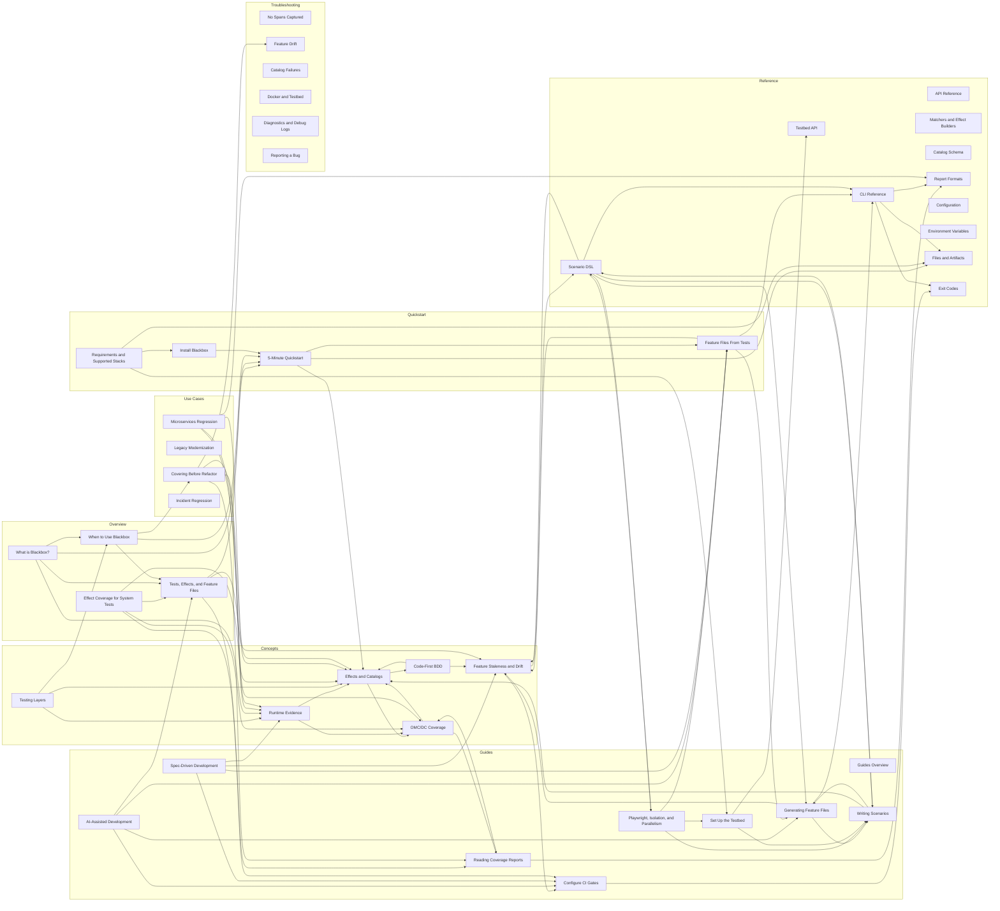

# Blackbox Docs Link Graph

Generated by `pnpm docs:graph` from the public Blackbox sidebar and internal Markdown/MDX links.

- Source docs: `src/content/docs/blackbox`
- Public IA source: `src/config/sidebar.ts`
- Public pages: 43
- Internal public links: 76

## Graph

## What The Graph Says

- The graph only includes pages that are present in the public Blackbox sidebar.
- Overview and Quickstart pages should point readers into concepts, guides, and reference pages when they need depth.
- Reference and troubleshooting pages may be sinks, but they should usually offer a recovery or next-step link back to a workflow.
- Pages with no incoming links are reachable from the sidebar, but not from the reading journey. That is a signal to add contextual links or confirm they are pure lookup pages.

## Edges

- Code-First BDD
  - Effects and Catalogs
  - Feature Staleness and Drift
- Effects and Catalogs
  - Code-First BDD
  - OMC/DC Coverage
- Feature Staleness and Drift
  - Configure CI Gates
  - Scenario DSL
- OMC/DC Coverage
  - Effects and Catalogs
  - Reading Coverage Reports
- Runtime Evidence
  - Effects and Catalogs
  - OMC/DC Coverage
- Testing Layers
  - Effects and Catalogs
  - Runtime Evidence
  - When to Use Blackbox
- AI-Assisted Development
  - Configure CI Gates
  - Generating Feature Files
  - Tests, Effects, and Feature Files
  - Feature Files From Tests
- Configure CI Gates
  - Exit Codes
- Generating Feature Files
  - Feature Staleness and Drift
  - Writing Scenarios
  - CLI Reference
- Playwright, Isolation, and Parallelism
  - Set Up the Testbed
  - Writing Scenarios
  - Feature Files From Tests
  - Scenario DSL
- Reading Coverage Reports
  - OMC/DC Coverage
  - Report Formats
- Set Up the Testbed
  - Writing Scenarios
  - Testbed API
- Spec-Driven Development
  - Feature Staleness and Drift
  - Runtime Evidence
  - Configure CI Gates
  - Feature Files From Tests
- Writing Scenarios
  - Effects and Catalogs
  - Generating Feature Files
  - Scenario DSL
- Effect Coverage for System Tests
  - Effects and Catalogs
  - OMC/DC Coverage
  - Reading Coverage Reports
  - Tests, Effects, and Feature Files
- Tests, Effects, and Feature Files
  - Feature Staleness and Drift
  - Configure CI Gates
  - 5-Minute Quickstart
- What is Blackbox?
  - Runtime Evidence
  - Tests, Effects, and Feature Files
  - When to Use Blackbox
  - 5-Minute Quickstart
- When to Use Blackbox
  - Tests, Effects, and Feature Files
  - 5-Minute Quickstart
  - Covering Before Refactor
- Feature Files From Tests
  - Feature Staleness and Drift
  - Generating Feature Files
  - CLI Reference
- 5-Minute Quickstart
  - Effects and Catalogs
  - Feature Files From Tests
  - Files and Artifacts
- Install Blackbox
  - 5-Minute Quickstart
- Requirements and Supported Stacks
  - Set Up the Testbed
  - Install Blackbox
  - Files and Artifacts
- CLI Reference
  - Exit Codes
  - Files and Artifacts
  - Report Formats
- Scenario DSL
  - Feature Staleness and Drift
  - Generating Feature Files
  - Playwright, Isolation, and Parallelism
  - Writing Scenarios
  - CLI Reference
- Covering Before Refactor
  - Effects and Catalogs
  - Runtime Evidence
  - Reading Coverage Reports
  - Feature Drift
- Microservices Regression
  - Effects and Catalogs
  - OMC/DC Coverage
  - Runtime Evidence
  - Report Formats

## No Outgoing Internal Links

- API Reference (/docs/blackbox/reference/api)
- Catalog Schema (/docs/blackbox/reference/catalog-schema)
- Configuration (/docs/blackbox/reference/configuration)
- Environment Variables (/docs/blackbox/reference/environment-variables)
- Exit Codes (/docs/blackbox/reference/exit-codes)
- Files and Artifacts (/docs/blackbox/reference/files-and-artifacts)
- Matchers and Effect Builders (/docs/blackbox/reference/matchers-and-effect-builders)
- Report Formats (/docs/blackbox/reference/report-formats)
- Testbed API (/docs/blackbox/reference/testbed-api)
- Catalog Failures (/docs/blackbox/troubleshooting/catalog-failures)
- Diagnostics and Debug Logs (/docs/blackbox/troubleshooting/diagnostics-and-debug-logs)
- Docker and Testbed (/docs/blackbox/troubleshooting/docker-and-testbed)
- Feature Drift (/docs/blackbox/troubleshooting/feature-drift)
- No Spans Captured (/docs/blackbox/troubleshooting/no-spans-captured)
- Reporting a Bug (/docs/blackbox/troubleshooting/reporting-a-bug)
- Incident Regression (/docs/blackbox/use-cases/incident-regression)
- Legacy Modernization (/docs/blackbox/use-cases/legacy-modernization)

## No Incoming Internal Links

- Testing Layers (/docs/blackbox/concepts/testing-layers)
- AI-Assisted Development (/docs/blackbox/guides/ai-assisted-development)
- Spec-Driven Development (/docs/blackbox/guides/spec-driven-development)
- Effect Coverage for System Tests (/docs/blackbox/overview/system-test-effect-coverage)
- What is Blackbox? (/docs/blackbox/overview/what-is-blackbox)
- Requirements and Supported Stacks (/docs/blackbox/quickstart/requirements)
- API Reference (/docs/blackbox/reference/api)
- Catalog Schema (/docs/blackbox/reference/catalog-schema)
- Configuration (/docs/blackbox/reference/configuration)
- Environment Variables (/docs/blackbox/reference/environment-variables)
- Matchers and Effect Builders (/docs/blackbox/reference/matchers-and-effect-builders)
- Catalog Failures (/docs/blackbox/troubleshooting/catalog-failures)
- Diagnostics and Debug Logs (/docs/blackbox/troubleshooting/diagnostics-and-debug-logs)
- Docker and Testbed (/docs/blackbox/troubleshooting/docker-and-testbed)
- No Spans Captured (/docs/blackbox/troubleshooting/no-spans-captured)
- Reporting a Bug (/docs/blackbox/troubleshooting/reporting-a-bug)
- Incident Regression (/docs/blackbox/use-cases/incident-regression)
- Legacy Modernization (/docs/blackbox/use-cases/legacy-modernization)
- Microservices Regression (/docs/blackbox/use-cases/microservices-regression)

## Sidebar Routes Missing Source Files

- /docs/blackbox/guides

## Docs On Disk But Not In Public Sidebar

- Guides Overview (/docs/blackbox/guides/index)
