# Blackbox Docs Link Graph

Generated by `pnpm docs:graph` from the public Blackbox sidebar and internal Markdown/MDX links.

- Source docs: `src/content/docs/blackbox`
- Public IA source: `src/config/sidebar.ts`
- Public pages: 25
- Internal public links: 63

## Graph

```mermaid
flowchart LR
  subgraph Overview["Overview"]
    overview_what_is_blackbox["What is Blackbox?"]
    overview_how_blackbox_works["How Blackbox Works"]
  end
  subgraph Get_Started["Get Started"]
    quickstart["Get Started"]
    quickstart_build_behavioral_harness["Start From an Existing Test"]
    quickstart_add_to_existing_test["Connect Your Application With Compose"]
  end
  subgraph Concepts["Concepts"]
    concepts_human_agent_verification_loop["Human Authority and the Agent Loop"]
    concepts_runtime_evidence["Runtime Evidence and Integrity"]
    concepts_effects_and_catalogs["OpenTelemetry and Effects"]
    concepts_omc_dc_coverage["Observable Decision Coverage"]
    concepts_testing_layers["System and E2E Verification"]
  end
  subgraph Guides["Guides"]
    guides_set_up_the_testbed["Choose How Blackbox Runs Your Application"]
    guides_use_existing_compose["Use an Existing Compose Project"]
    guides_playwright_isolation_and_parallelism["Test Topologies and Parallelism"]
    guides_agent_skills["Use Blackbox With Coding Agents"]
    guides_reports_and_ci_gates["Add Blackbox to CI"]
    guides_source_maps_and_service_layouts["Configure Source Maps and Service Layouts"]
  end
  subgraph Future_Setup_Paths["Future Setup Paths"]
    guides_build_from_dockerfile["Build From a Dockerfile"]
    guides_run_compiled_artifacts["Run Compiled Artifacts"]
  end
  subgraph Reference["Reference"]
    reference["Reference"]
    reference_plans_and_realizations["Plans, Alignment, and Identity"]
    reference_capture_lifecycle_and_correlation["Capture Lifecycle and Evidence"]
    reference_effects_and_claims["Effects and Claim Evaluation"]
    reference_cli["CLI and Exit Behavior"]
  end
  subgraph Operations["Operations"]
    operations_security_and_data_handling["Security and Data Handling"]
  end
  subgraph Status["Status"]
    status_alpha_status["Alpha Status"]
  end
  concepts_effects_and_catalogs --> concepts_omc_dc_coverage
  concepts_effects_and_catalogs --> reference_effects_and_claims
  concepts_human_agent_verification_loop --> overview_how_blackbox_works
  concepts_human_agent_verification_loop --> reference_plans_and_realizations
  concepts_omc_dc_coverage --> concepts_testing_layers
  concepts_runtime_evidence --> concepts_effects_and_catalogs
  concepts_runtime_evidence --> reference_capture_lifecycle_and_correlation
  concepts_testing_layers --> concepts_runtime_evidence
  concepts_testing_layers --> quickstart
  guides_agent_skills --> concepts_human_agent_verification_loop
  guides_agent_skills --> guides_reports_and_ci_gates
  guides_build_from_dockerfile --> guides_use_existing_compose
  guides_playwright_isolation_and_parallelism --> concepts_omc_dc_coverage
  guides_playwright_isolation_and_parallelism --> reference_capture_lifecycle_and_correlation
  guides_reports_and_ci_gates --> operations_security_and_data_handling
  guides_reports_and_ci_gates --> reference_cli
  guides_run_compiled_artifacts --> guides_use_existing_compose
  guides_set_up_the_testbed --> guides_build_from_dockerfile
  guides_set_up_the_testbed --> guides_run_compiled_artifacts
  guides_set_up_the_testbed --> guides_use_existing_compose
  guides_source_maps_and_service_layouts --> reference_plans_and_realizations
  guides_source_maps_and_service_layouts --> status_alpha_status
  guides_use_existing_compose --> guides_playwright_isolation_and_parallelism
  guides_use_existing_compose --> operations_security_and_data_handling
  operations_security_and_data_handling --> reference_capture_lifecycle_and_correlation
  operations_security_and_data_handling --> status_alpha_status
  overview_how_blackbox_works --> concepts_human_agent_verification_loop
  overview_how_blackbox_works --> concepts_omc_dc_coverage
  overview_how_blackbox_works --> concepts_runtime_evidence
  overview_how_blackbox_works --> quickstart
  overview_how_blackbox_works --> reference_plans_and_realizations
  overview_what_is_blackbox --> concepts_effects_and_catalogs
  overview_what_is_blackbox --> concepts_omc_dc_coverage
  overview_what_is_blackbox --> overview_how_blackbox_works
  overview_what_is_blackbox --> quickstart
  quickstart --> guides_agent_skills
  quickstart --> overview_how_blackbox_works
  quickstart --> quickstart_add_to_existing_test
  quickstart --> quickstart_build_behavioral_harness
  quickstart_add_to_existing_test --> concepts_runtime_evidence
  quickstart_add_to_existing_test --> guides_use_existing_compose
  quickstart_build_behavioral_harness --> quickstart_add_to_existing_test
  reference --> operations_security_and_data_handling
  reference --> reference_capture_lifecycle_and_correlation
  reference --> reference_cli
  reference --> reference_effects_and_claims
  reference --> reference_plans_and_realizations
  reference --> status_alpha_status
  reference_capture_lifecycle_and_correlation --> concepts_runtime_evidence
  reference_capture_lifecycle_and_correlation --> guides_playwright_isolation_and_parallelism
  reference_capture_lifecycle_and_correlation --> reference_effects_and_claims
  reference_cli --> guides_reports_and_ci_gates
  reference_cli --> reference_effects_and_claims
  reference_effects_and_claims --> concepts_effects_and_catalogs
  reference_effects_and_claims --> concepts_runtime_evidence
  reference_effects_and_claims --> reference_capture_lifecycle_and_correlation
  reference_plans_and_realizations --> concepts_human_agent_verification_loop
  reference_plans_and_realizations --> guides_source_maps_and_service_layouts
  reference_plans_and_realizations --> reference_capture_lifecycle_and_correlation
  status_alpha_status --> guides_build_from_dockerfile
  status_alpha_status --> guides_run_compiled_artifacts
  status_alpha_status --> guides_set_up_the_testbed
  status_alpha_status --> quickstart
```

## What The Graph Says

- The graph only includes pages that are present in the public Blackbox sidebar.
- Overview and Get Started pages should point readers into concepts, guides, and reference pages when they need depth.
- Reference pages may be sinks, but they should usually offer a next-step link back to a workflow.
- Pages with no incoming links are reachable from the sidebar, but not from the reading journey. That is a signal to add contextual links or confirm they are pure lookup pages.

## Edges

- OpenTelemetry and Effects
  - Observable Decision Coverage
  - Effects and Claim Evaluation
- Human Authority and the Agent Loop
  - How Blackbox Works
  - Plans, Alignment, and Identity
- Observable Decision Coverage
  - System and E2E Verification
- Runtime Evidence and Integrity
  - OpenTelemetry and Effects
  - Capture Lifecycle and Evidence
- System and E2E Verification
  - Runtime Evidence and Integrity
  - Get Started
- Use Blackbox With Coding Agents
  - Human Authority and the Agent Loop
  - Add Blackbox to CI
- Build From a Dockerfile
  - Use an Existing Compose Project
- Test Topologies and Parallelism
  - Observable Decision Coverage
  - Capture Lifecycle and Evidence
- Add Blackbox to CI
  - Security and Data Handling
  - CLI and Exit Behavior
- Run Compiled Artifacts
  - Use an Existing Compose Project
- Choose How Blackbox Runs Your Application
  - Build From a Dockerfile
  - Run Compiled Artifacts
  - Use an Existing Compose Project
- Configure Source Maps and Service Layouts
  - Plans, Alignment, and Identity
  - Alpha Status
- Use an Existing Compose Project
  - Test Topologies and Parallelism
  - Security and Data Handling
- Security and Data Handling
  - Capture Lifecycle and Evidence
  - Alpha Status
- How Blackbox Works
  - Human Authority and the Agent Loop
  - Observable Decision Coverage
  - Runtime Evidence and Integrity
  - Get Started
  - Plans, Alignment, and Identity
- What is Blackbox?
  - OpenTelemetry and Effects
  - Observable Decision Coverage
  - How Blackbox Works
  - Get Started
- Get Started
  - Use Blackbox With Coding Agents
  - How Blackbox Works
  - Connect Your Application With Compose
  - Start From an Existing Test
- Connect Your Application With Compose
  - Runtime Evidence and Integrity
  - Use an Existing Compose Project
- Start From an Existing Test
  - Connect Your Application With Compose
- Reference
  - Security and Data Handling
  - Capture Lifecycle and Evidence
  - CLI and Exit Behavior
  - Effects and Claim Evaluation
  - Plans, Alignment, and Identity
  - Alpha Status
- Capture Lifecycle and Evidence
  - Runtime Evidence and Integrity
  - Test Topologies and Parallelism
  - Effects and Claim Evaluation
- CLI and Exit Behavior
  - Add Blackbox to CI
  - Effects and Claim Evaluation
- Effects and Claim Evaluation
  - OpenTelemetry and Effects
  - Runtime Evidence and Integrity
  - Capture Lifecycle and Evidence
- Plans, Alignment, and Identity
  - Human Authority and the Agent Loop
  - Configure Source Maps and Service Layouts
  - Capture Lifecycle and Evidence
- Alpha Status
  - Build From a Dockerfile
  - Run Compiled Artifacts
  - Choose How Blackbox Runs Your Application
  - Get Started

## No Outgoing Internal Links

## No Incoming Internal Links

- What is Blackbox? (/docs/blackbox/overview/what-is-blackbox)
- Reference (/docs/blackbox/reference)
