# Blackbox Docs Link Graph

Generated by `pnpm docs:graph` from the public Blackbox sidebar and internal Markdown/MDX links.

- Source docs: `src/content/docs/blackbox`
- Public IA source: `src/config/sidebar.ts`
- Public pages: 22
- Internal public links: 45

## Graph

```mermaid
flowchart LR
  subgraph Overview["Overview"]
    overview_what_is_blackbox["What is Blackbox?"]
    overview_runtime_evidence_gap["Intent, Flows, and Runtime Evidence"]
    overview_verification_loop["The Verification Loop"]
    overview_adopt_blackbox_in_layers["Adopt Blackbox in Layers"]
    overview_when_to_use_blackbox["When to Use Blackbox"]
  end
  subgraph Quickstart["Quickstart"]
    quickstart_prerequisites_and_supported_systems["Prerequisites and Supported Systems"]
    quickstart_install["Install Blackbox"]
    quickstart_first_proven_feature["5-Minute Quickstart"]
    quickstart_connect_specifications_to_runtime_evidence["Spec-Driven Verification Quickstart"]
  end
  subgraph Concepts["Concepts"]
    concepts_testing_layers["Testing Layers"]
    concepts_runtime_evidence["Runtime Evidence"]
    concepts_effects_and_catalogs["Effects, Contracts, and Coverage"]
    concepts_specifications_flows_and_verdicts["Requirements, Flows, and Verdicts"]
    concepts_omc_dc_coverage["Observable Decision Coverage"]
  end
  subgraph Guides["Guides"]
    guides_set_up_the_testbed["Testbed and Instrumentation"]
    guides_playwright_isolation_and_parallelism["Playwright Flows, Isolation, and Parallelism"]
    guides_spec_driven_and_agentic_verification["Spec-Driven and Agentic Verification"]
    guides_agent_skills["Agent Skills"]
    guides_reports_and_ci_gates["Reports and CI Gates"]
  end
  subgraph Use_Cases["Use Cases"]
    use_cases["Use Cases"]
  end
  subgraph Reference["Reference"]
    reference["Reference"]
  end
  subgraph Troubleshooting["Troubleshooting"]
    troubleshooting["Troubleshooting"]
  end
  concepts_effects_and_catalogs --> concepts_omc_dc_coverage
  concepts_effects_and_catalogs --> concepts_specifications_flows_and_verdicts
  concepts_omc_dc_coverage --> guides_reports_and_ci_gates
  concepts_runtime_evidence --> concepts_effects_and_catalogs
  concepts_runtime_evidence --> reference
  concepts_specifications_flows_and_verdicts --> guides_spec_driven_and_agentic_verification
  concepts_specifications_flows_and_verdicts --> quickstart_connect_specifications_to_runtime_evidence
  concepts_testing_layers --> concepts_runtime_evidence
  guides_reports_and_ci_gates --> reference
  guides_set_up_the_testbed --> guides_playwright_isolation_and_parallelism
  guides_set_up_the_testbed --> troubleshooting
  guides_spec_driven_and_agentic_verification --> guides_agent_skills
  guides_spec_driven_and_agentic_verification --> guides_reports_and_ci_gates
  overview_adopt_blackbox_in_layers --> concepts_omc_dc_coverage
  overview_adopt_blackbox_in_layers --> overview_when_to_use_blackbox
  overview_adopt_blackbox_in_layers --> quickstart_connect_specifications_to_runtime_evidence
  overview_adopt_blackbox_in_layers --> quickstart_first_proven_feature
  overview_runtime_evidence_gap --> overview_verification_loop
  overview_verification_loop --> guides_agent_skills
  overview_verification_loop --> overview_adopt_blackbox_in_layers
  overview_verification_loop --> quickstart_connect_specifications_to_runtime_evidence
  overview_what_is_blackbox --> overview_adopt_blackbox_in_layers
  overview_what_is_blackbox --> overview_verification_loop
  overview_what_is_blackbox --> quickstart_connect_specifications_to_runtime_evidence
  overview_what_is_blackbox --> quickstart_first_proven_feature
  overview_when_to_use_blackbox --> overview_adopt_blackbox_in_layers
  overview_when_to_use_blackbox --> quickstart_first_proven_feature
  overview_when_to_use_blackbox --> quickstart_prerequisites_and_supported_systems
  overview_when_to_use_blackbox --> use_cases
  quickstart_connect_specifications_to_runtime_evidence --> guides_agent_skills
  quickstart_connect_specifications_to_runtime_evidence --> guides_reports_and_ci_gates
  quickstart_connect_specifications_to_runtime_evidence --> quickstart_install
  quickstart_first_proven_feature --> guides_reports_and_ci_gates
  quickstart_first_proven_feature --> quickstart_connect_specifications_to_runtime_evidence
  quickstart_first_proven_feature --> quickstart_install
  quickstart_first_proven_feature --> reference
  quickstart_install --> quickstart_first_proven_feature
  quickstart_prerequisites_and_supported_systems --> guides_set_up_the_testbed
  quickstart_prerequisites_and_supported_systems --> quickstart_install
  troubleshooting --> concepts_effects_and_catalogs
  troubleshooting --> guides_reports_and_ci_gates
  troubleshooting --> guides_set_up_the_testbed
  troubleshooting --> quickstart_prerequisites_and_supported_systems
  use_cases --> overview_when_to_use_blackbox
  use_cases --> quickstart_first_proven_feature
```

## What The Graph Says

- The graph only includes pages that are present in the public Blackbox sidebar.
- Overview and Quickstart pages should point readers into concepts, guides, and reference pages when they need depth.
- Reference and troubleshooting pages may be sinks, but they should usually offer a recovery or next-step link back to a workflow.
- Pages with no incoming links are reachable from the sidebar, but not from the reading journey. That is a signal to add contextual links or confirm they are pure lookup pages.

## Edges

- Effects, Contracts, and Coverage
  - Observable Decision Coverage
  - Requirements, Flows, and Verdicts
- Observable Decision Coverage
  - Reports and CI Gates
- Runtime Evidence
  - Effects, Contracts, and Coverage
  - Reference
- Requirements, Flows, and Verdicts
  - Spec-Driven and Agentic Verification
  - Spec-Driven Verification Quickstart
- Testing Layers
  - Runtime Evidence
- Reports and CI Gates
  - Reference
- Testbed and Instrumentation
  - Playwright Flows, Isolation, and Parallelism
  - Troubleshooting
- Spec-Driven and Agentic Verification
  - Agent Skills
  - Reports and CI Gates
- Adopt Blackbox in Layers
  - Observable Decision Coverage
  - When to Use Blackbox
  - Spec-Driven Verification Quickstart
  - 5-Minute Quickstart
- Intent, Flows, and Runtime Evidence
  - The Verification Loop
- The Verification Loop
  - Agent Skills
  - Adopt Blackbox in Layers
  - Spec-Driven Verification Quickstart
- What is Blackbox?
  - Adopt Blackbox in Layers
  - The Verification Loop
  - Spec-Driven Verification Quickstart
  - 5-Minute Quickstart
- When to Use Blackbox
  - Adopt Blackbox in Layers
  - 5-Minute Quickstart
  - Prerequisites and Supported Systems
  - Use Cases
- Spec-Driven Verification Quickstart
  - Agent Skills
  - Reports and CI Gates
  - Install Blackbox
- 5-Minute Quickstart
  - Reports and CI Gates
  - Spec-Driven Verification Quickstart
  - Install Blackbox
  - Reference
- Install Blackbox
  - 5-Minute Quickstart
- Prerequisites and Supported Systems
  - Testbed and Instrumentation
  - Install Blackbox
- Troubleshooting
  - Effects, Contracts, and Coverage
  - Reports and CI Gates
  - Testbed and Instrumentation
  - Prerequisites and Supported Systems
- Use Cases
  - When to Use Blackbox
  - 5-Minute Quickstart

## No Outgoing Internal Links

- Agent Skills (/docs/blackbox/guides/agent-skills)
- Playwright Flows, Isolation, and Parallelism (/docs/blackbox/guides/playwright-isolation-and-parallelism)
- Reference (/docs/blackbox/reference)

## No Incoming Internal Links

- Testing Layers (/docs/blackbox/concepts/testing-layers)
- Intent, Flows, and Runtime Evidence (/docs/blackbox/overview/runtime-evidence-gap)
- What is Blackbox? (/docs/blackbox/overview/what-is-blackbox)

## Docs On Disk But Not In Public Sidebar

- Gherkin Without BDD Theater (/docs/blackbox/concepts/code-first-bdd)
- Generate Gherkin From Existing Tests (/docs/blackbox/guides/generating-feature-files)
- Write Playwright Flows (/docs/blackbox/guides/writing-scenarios)
- API Reference (/docs/blackbox/reference/api)
- Effect Contract Schema (/docs/blackbox/reference/catalog-schema)
- CLI Reference (/docs/blackbox/reference/cli)
- Project Conventions (/docs/blackbox/reference/configuration)
- Environment Variables (/docs/blackbox/reference/environment-variables)
- Exit Codes (/docs/blackbox/reference/exit-codes)
- Files and Artifacts (/docs/blackbox/reference/files-and-artifacts)
- Matchers and Effect Builders (/docs/blackbox/reference/matchers-and-effect-builders)
- Report Formats (/docs/blackbox/reference/report-formats)
- Playwright Flow Tags (/docs/blackbox/reference/scenario-dsl)
- Testbed API (/docs/blackbox/reference/testbed-api)
- Effect Contract Failures (/docs/blackbox/troubleshooting/catalog-failures)
- Diagnostics and Debug Logs (/docs/blackbox/troubleshooting/diagnostics-and-debug-logs)
- Docker and Testbed (/docs/blackbox/troubleshooting/docker-and-testbed)
- Feature Drift (/docs/blackbox/troubleshooting/feature-drift)
- No Spans Captured (/docs/blackbox/troubleshooting/no-spans-captured)
- Reporting a Bug (/docs/blackbox/troubleshooting/reporting-a-bug)
- Covering Before Refactor (/docs/blackbox/use-cases/covering-before-refactor)
- Incident Regression (/docs/blackbox/use-cases/incident-regression)
- Legacy Modernization (/docs/blackbox/use-cases/legacy-modernization)
- Microservices Regression (/docs/blackbox/use-cases/microservices-regression)

## Public Pages Linking Outside The Public Sidebar

- Adopt Blackbox in Layers
  - /docs/blackbox/guides/generating-feature-files
- Prerequisites and Supported Systems
  - /docs/blackbox/reference/files-and-artifacts
- Reference
  - /docs/blackbox/reference/api
  - /docs/blackbox/reference/catalog-schema
  - /docs/blackbox/reference/cli
  - /docs/blackbox/reference/configuration
  - /docs/blackbox/reference/environment-variables
  - /docs/blackbox/reference/exit-codes
  - /docs/blackbox/reference/files-and-artifacts
  - /docs/blackbox/reference/matchers-and-effect-builders
  - /docs/blackbox/reference/report-formats
  - /docs/blackbox/reference/scenario-dsl
  - /docs/blackbox/reference/testbed-api
- Troubleshooting
  - /docs/blackbox/troubleshooting/catalog-failures
  - /docs/blackbox/troubleshooting/diagnostics-and-debug-logs
  - /docs/blackbox/troubleshooting/docker-and-testbed
  - /docs/blackbox/troubleshooting/feature-drift
  - /docs/blackbox/troubleshooting/no-spans-captured
  - /docs/blackbox/troubleshooting/reporting-a-bug
- Use Cases
  - /docs/blackbox/use-cases/covering-before-refactor
  - /docs/blackbox/use-cases/incident-regression
  - /docs/blackbox/use-cases/legacy-modernization
  - /docs/blackbox/use-cases/microservices-regression
