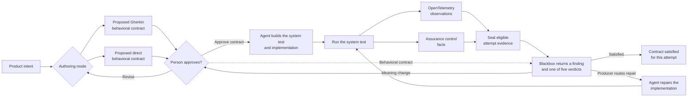

# Blackbox Verification Loop North Star

> Internal product reference for evaluating Blackbox features, documentation, demos, and agent workflows.

Blackbox turns product intent into a human-approved behavioral contract and connects it to an executable system test. It combines the native test result with runtime evidence to return deterministic findings that keep coding agents repairing the implementation against that contract.

## The Loop

The person controls the behavioral contract. The agent may propose the contract, build tests, implement it, and repair failures, but it cannot change the approved contract to make a finding pass.

## What Blackbox Adds

- **Feedforward:** The approved behavioral contract guides the agent before it implements the behavior.
- **Runtime verification:** System-test assertions check the visible result. OpenTelemetry observations reveal supported system work, while separate control facts establish evidence eligibility and limits.
- **Deterministic feedback:** The same behavioral contract, declared test, analysis rules, and sealed evidence produce the same finding.
- **Verdict-aware repair:** Findings preserve the producer-owned repair owner, permitted actions, and earliest rerun gate. Changes to the behavioral contract return to a person for approval.

## Non-Negotiable Boundaries

- Every case attempt, retry, and sequence member receives fresh managed capture.
- Runtime effects are the core evidence used to verify behavior beyond the visible test result. Effects never create or change the behavioral contract.
- Incomplete evidence cannot prove absence, an upper bound, or an exact count.
- Observable Decision Coverage may add insight after effect analysis, but it cannot change an ordinary effect finding.
- A distributed system may behave differently between runs. Determinism applies to analysis of fixed inputs and evidence.

## Product Test

Every addition to Blackbox should strengthen at least one part of this loop: translating intent, approving the behavioral contract, realizing a test, capturing evidence, producing findings, or guiding repair. It must not weaken human authority over the contract.
